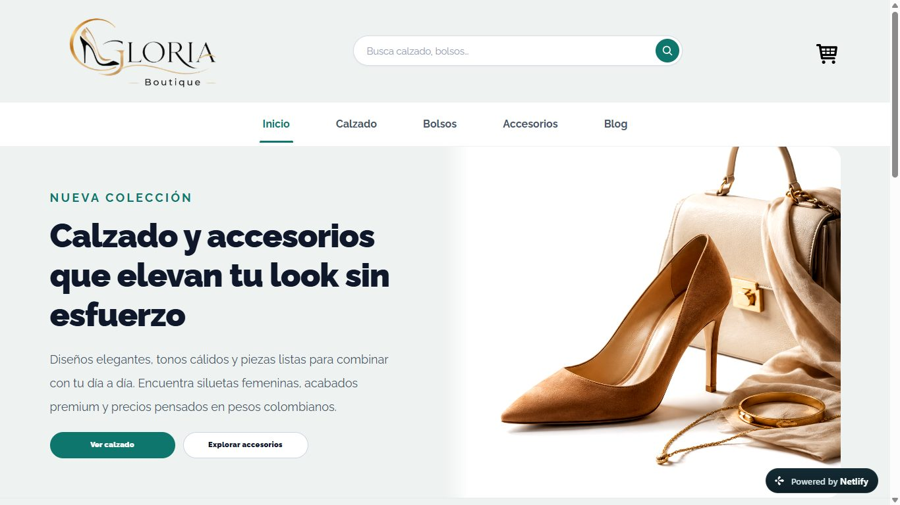
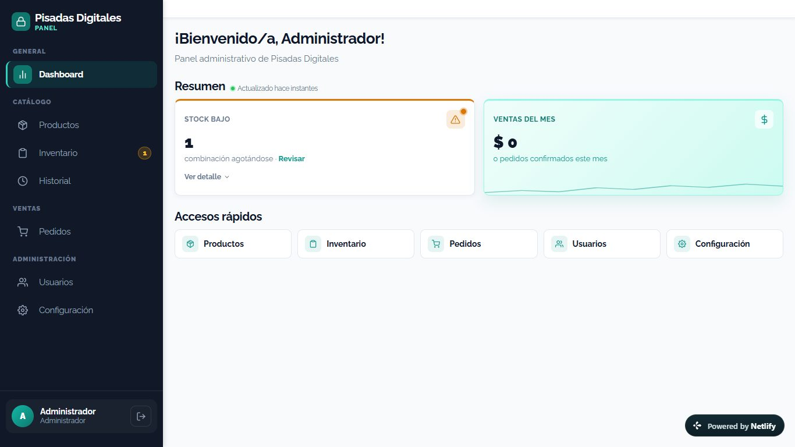
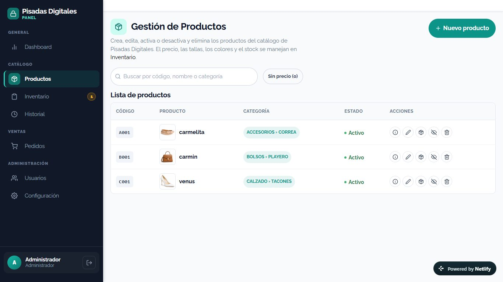
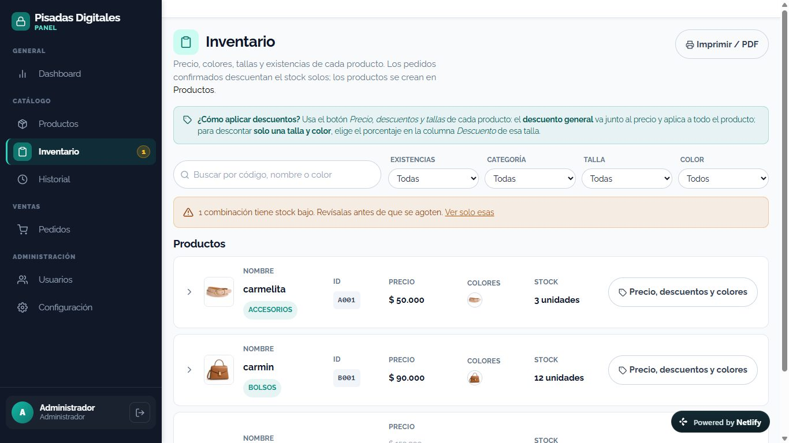
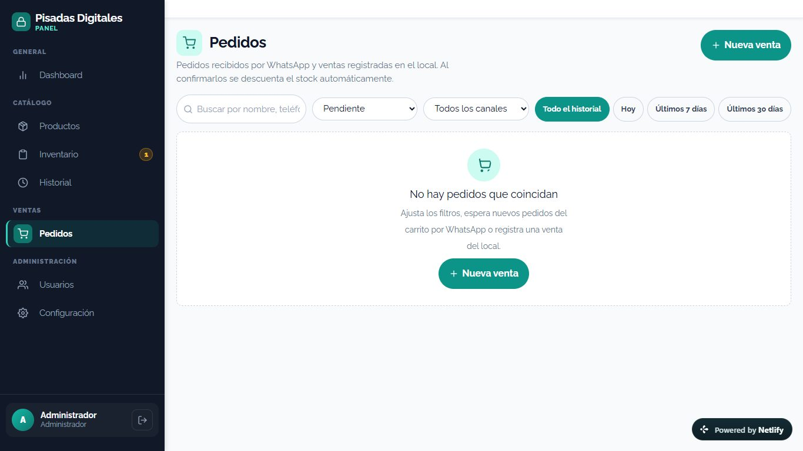
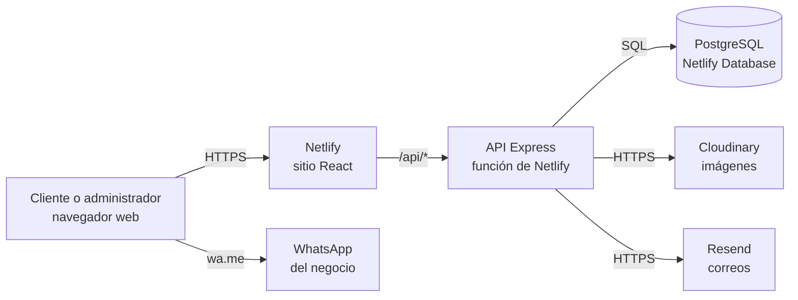

# 👠 Pisadas Digitales

**Plataforma SaaS de catálogo digital y gestión comercial para microempresas de calzado**

Catálogo administrable · Inventario por talla y color · Pedidos por WhatsApp · Panel con roles

---

## 📌 Acerca del proyecto

**Pisadas Digitales** es el proyecto de grado de **Vanessa Osorio Ortiz** (Ingeniería de Software, UNIMINUTO, modalidad Emprendimiento y Empresarialidad). Es una plataforma web que permite a las microempresas de calzado de Santiago de Cali tener un **catálogo digital propio, administrable desde el celular**, que convierte las visitas en **pedidos por WhatsApp**, con control de inventario por talla y color.

La demo publicada corresponde al primer comercio vinculado, **Gloria Boutique**, con datos de ejemplo.

> 🔒 Este repositorio es **solo de presentación**: contiene la documentación y las capturas de la demo. El código fuente se mantiene en un repositorio privado.

---

## 🚀 Demo en vivo

| Recurso | Enlace |
|---|---|
| 🛍️ Tienda (catálogo público) | **https://pisadas-digitales-vanessa-osorio.netlify.app** |
| 🔐 Panel administrativo | **https://pisadas-digitales-vanessa-osorio.netlify.app/auth/login** |

### Cuenta de prueba

| Rol | Correo | Contraseña |
|---|---|---|
| Gestor de catálogo | `gestor.demo@pisadasdigitales.com` | `Demo-pbaHbkR-7!` |

> La cuenta de **administrador** se entrega de forma privada al docente evaluador.
> Los datos de la demo son de ejemplo: no contienen información real de clientes ni ventas.

---

## ✨ Funcionalidades

### 🛍️ Tienda para el cliente
- **Catálogo por categorías y subcategorías** con filtros de talla, color y precio, y paginación de 12 productos.
- **Búsqueda con sugerencias** mientras se escribe: por nombre, categoría, color o referencia del producto, sin importar tildes.
- **Detalle del producto** con fotos por color, tallas disponibles, referencia y descuentos.
- **Carrito en panel lateral** que valida precios y existencias con el servidor antes de enviar.
- **Pedido por WhatsApp**: el pedido se registra en el sistema y se abre WhatsApp con el mensaje armado (número de pedido, productos, tallas y total), sin duplicados.
- **Diseño responsive**, pensado primero para el celular.

### 🧭 Panel administrativo
- **Dashboard** con stock bajo, ventas del mes y productos más vendidos.
- **Gestión de productos (CRUD)**: crear, editar, activar o desactivar y eliminar, con galería de fotos en Cloudinary y referencia automática (C001, B001…).
- **Inventario por talla y color**: entradas, salidas y ajustes con historial, alertas de stock bajo y descuentos por combinación.
- **Pedidos**: confirmar, cancelar o reabrir pedidos de WhatsApp, y registrar ventas presenciales; el stock se descuenta al confirmar.
- **Historial de movimientos** con filtros y reporte en PDF.
- **Usuarios y roles (RBAC)**: administrador y gestor de catálogo, con permisos diferenciados.
- **Configuración**: nombre del negocio, logo, número de WhatsApp, umbral de stock y categorías (hasta 6), con portadas de imagen uniformes.

### 🔐 Seguridad
- Autenticación con **JWT** y contraseñas cifradas con **Bcrypt**.
- **Control de acceso por roles** en el servidor y en la interfaz.
- **Límite de intentos** en el inicio de sesión, la recuperación de contraseña y los pedidos.
- Precios y existencias **calculados en el servidor**: el cliente nunca define el precio de un pedido.

---

## 🖼️ Capturas

| Catálogo con filtros | Detalle del producto |
|---|---|
|  |  |

| Carrito y pedido por WhatsApp | Inicio de sesión |
|---|---|
|  |  |

| Dashboard | Gestión de productos |
|---|---|
|  |  |

| Inventario por talla y color | Pedidos |
|---|---|
|  |  |

---

## 🛠️ Stack tecnológico

| Capa | Tecnologías |
|---|---|
| **Frontend** | React 19, TypeScript, Vite, React Router, TanStack Query, React Hook Form, Bootstrap |
| **Backend** | Node.js 22, Express 5, TypeScript, express-validator, JWT, Bcrypt |
| **Base de datos** | PostgreSQL (13 tablas, 17 relaciones, triggers para la referencia de productos) |
| **Servicios** | Cloudinary (imágenes), Resend (correo de recuperación), WhatsApp (pedidos) |
| **Despliegue de la demo** | Netlify (sitio y API como función), Netlify Database (PostgreSQL) |
| **Despliegue propuesto en producción** | AWS Lightsail con Docker Compose (Nginx, Node.js y PostgreSQL) y Cloudflare |

---

## 🏗️ Arquitectura

La aplicación sigue una arquitectura de tres capas (presentación, lógica de negocio y datos) que se comunican mediante una **API REST**. Para producción se propone desplegarla en **AWS Lightsail** con **Docker Compose** y **Cloudflare** como DNS y proxy.

---

## 🗂️ Modelo de datos (resumen)

| Módulo | Tablas |
|---|---|
| Autenticación | `usuarios`, `password_reset_tokens` |
| Catálogo | `categorias`, `subcategorias`, `productos`, `producto_variantes`, `producto_imagenes`, `producto_color_imagenes` |
| Ventas e inventario | `pedidos`, `pedido_items`, `pedido_eventos`, `inventario_movimientos` |
| Configuración | `configuracion_tienda` |

---

## ✅ Calidad

- **238 pruebas automatizadas** del backend (autenticación, roles, catálogo, inventario, pedidos, búsqueda y límites de acceso).
- Tipado estricto con TypeScript en frontend y backend, y revisión con ESLint.

---

## 👩‍💻 Autora

**Vanessa Osorio Ortiz** — Ingeniería de Software, UNIMINUTO

- 📧 vanessaosorio.dev@gmail.com
- 🔗 [github.com/vanessa-osorio-dev](https://github.com/vanessa-osorio-dev)

Proyecto académico · Plan de negocio · Santiago de Cali, 2026
