

# 👠 Pisadas Digitales

**Plataforma SaaS de catálogo digital y gestión comercial para microempresas de calzado**

Catálogo administrable · Inventario por talla y color · Pedidos por WhatsApp · Panel con roles

---

## 📑 Contenido

1. [Acerca del proyecto](#-acerca-del-proyecto)
2. [Demo en vivo y cuentas de prueba](#-demo-en-vivo)
3. [Funcionalidades](#-funcionalidades)
4. [Capturas](#️-capturas)
5. [Arquitectura](#️-arquitectura)
6. [Seguridad](#-seguridad)
7. [Despliegue](#️-despliegue)
8. [Decisiones técnicas](#-decisiones-técnicas)
9. [Calidad y pruebas](#-calidad-y-pruebas)
10. [Competencias demostradas](#-competencias-demostradas)
11. [Autora](#-autora)

---

## 📌 Acerca del proyecto

**Pisadas Digitales** es una plataforma web que permite a las microempresas de calzado tener un **catálogo digital propio, administrable desde el celular**, que convierte las visitas en **pedidos por WhatsApp** y lleva el **control del inventario por talla y color**.

Nació como proyecto de grado de **Ingeniería de Software (UNIMINUTO, modalidad Emprendimiento y Empresarialidad)** y responde a una necesidad real identificada en el análisis de mercado: en Santiago de Cali existen **791 empresas activas del sector calzado**, el **95 %** son microempresas, y la mayoría vende por redes sociales sin un catálogo organizado.

### Construido desde cero

El proyecto fue desarrollado de principio a fin por su autora, cubriendo todo el ciclo de vida del software:

| Etapa | Qué se hizo |
|---|---|
| **Análisis** | Estudio de mercado (TAM, SAM, SOM), competencia y requisitos del comercio |
| **Diseño** | Arquitectura de tres capas, modelo de datos relacional, diseño de interfaz y de la API REST |
| **Desarrollo** | Frontend en React + TypeScript y backend en Node.js + Express + TypeScript |
| **Seguridad** | Autenticación JWT, cifrado Bcrypt, control de acceso por roles y límites de intentos |
| **Calidad** | 238 pruebas automatizadas del backend y tipado estricto en todo el proyecto |
| **Despliegue** | Demo en la nube y arquitectura de producción propuesta en AWS |
| **Documentación** | Plan de negocio, diagramas UML (despliegue, actividades, entidad-relación) y casos de uso |

La demo publicada corresponde al primer comercio vinculado, **Gloria Boutique**, con datos de ejemplo.

> 🔒 Este repositorio es **solo de presentación**: contiene la documentación técnica y las capturas de la demo. El código fuente se mantiene en un repositorio privado.

---

## 🚀 Demo en vivo

| Recurso | Enlace |
|---|---|
| 🛍️ Tienda (catálogo público) | **https://pisadas-digitales-vanessa-osorio.netlify.app** |
| 🔐 Panel administrativo | **https://pisadas-digitales-vanessa-osorio.netlify.app/auth/login** |

### Cuentas de prueba

| Rol | Correo | Contraseña | Qué puede ver |
|---|---|---|---|
| **Administrador** | `visitante.admin@pisadasdigitales.com` | `Visita-IMc3tI42026` | Todo el panel: dashboard, productos, inventario, historial, pedidos, usuarios y configuración |
| **Gestor de catálogo** | `gestor.demo@pisadasdigitales.com` | `Demo-pbaHbkR-7!` | El panel con los permisos del gestor (sin historial, usuarios ni configuración) |

> 👀 Las cuentas públicas están en **modo de solo lectura**: permiten recorrer todo el panel, pero no guardan cambios, para que la demo se conserve igual para todos los visitantes.
> Los datos son de ejemplo: no contienen información real de clientes ni ventas.

---

## ✨ Funcionalidades

### 🛍️ Tienda para el cliente
- **Catálogo por categorías y subcategorías** con filtros de talla, color y precio, y paginación de 12 productos.
- **Búsqueda con sugerencias** mientras se escribe: por nombre, categoría, color o referencia, sin importar tildes.
- **Detalle del producto** con fotos por color, tallas disponibles, referencia y descuentos.
- **Carrito en panel lateral** que valida precios y existencias con el servidor antes de enviar.
- **Pedido por WhatsApp**: el pedido se registra en el sistema y se abre WhatsApp con el mensaje armado (número de pedido, productos, tallas y total), sin duplicados.
- **Diseño responsive**, pensado primero para el celular.

### 🧭 Panel administrativo
- **Dashboard** con stock bajo, ventas del mes y productos más vendidos.
- **Gestión de productos (CRUD)** con galería de fotos en Cloudinary y referencia automática (C001, B001…).
- **Inventario por talla y color**: entradas, salidas y ajustes con historial, alertas de stock bajo y descuentos por combinación.
- **Pedidos**: confirmar, cancelar o reabrir pedidos de WhatsApp y registrar ventas presenciales; el stock se descuenta al confirmar.
- **Historial de movimientos** con filtros y reporte en PDF.
- **Usuarios y roles**: administrador y gestor de catálogo, con permisos diferenciados.
- **Configuración**: nombre del negocio, logo, WhatsApp, umbral de stock y categorías con portadas uniformes.

---

## 🖼️ Capturas

| Catálogo con filtros | Detalle del producto |
|---|---|
| 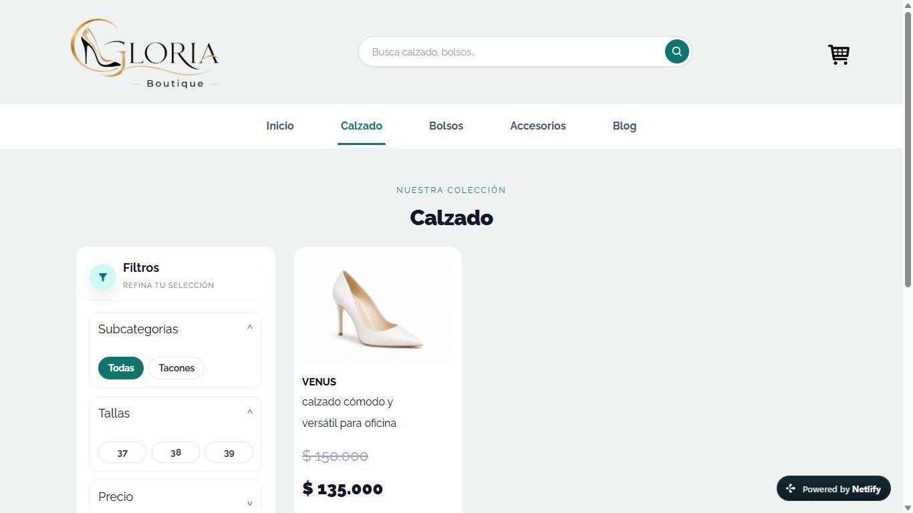 | 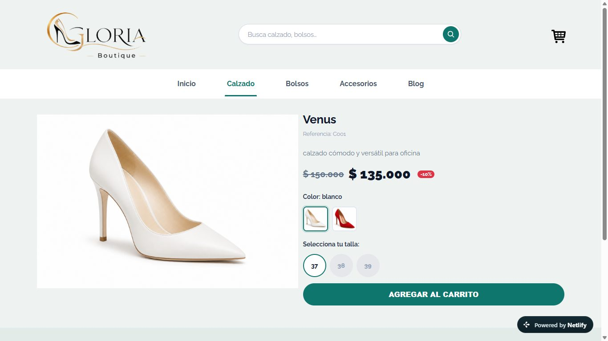 |

| Carrito y pedido por WhatsApp | Inicio de sesión |
|---|---|
| 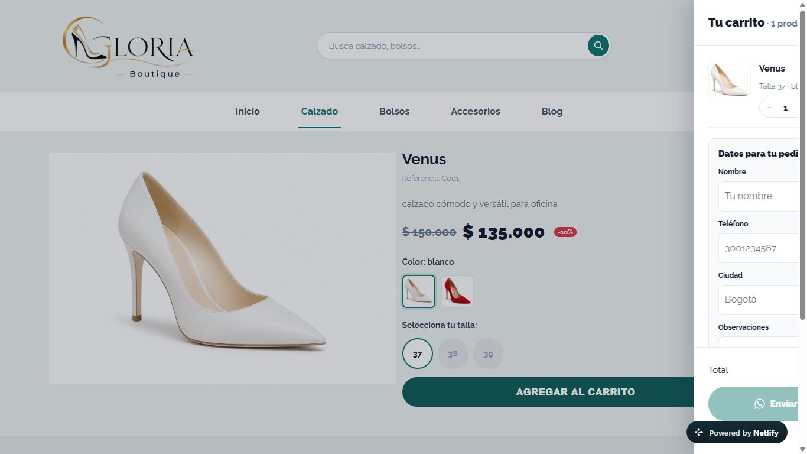 | 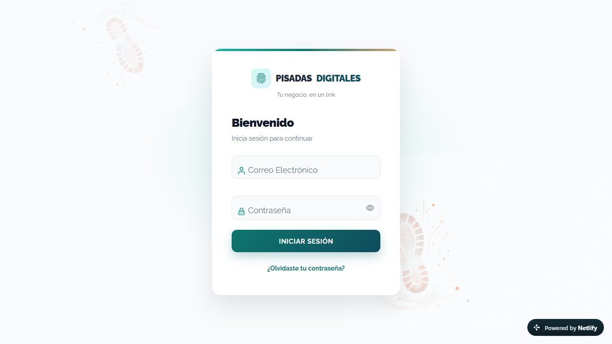 |

| Dashboard | Gestión de productos |
|---|---|
|  |  |

| Inventario por talla y color | Pedidos |
|---|---|
|  |  |

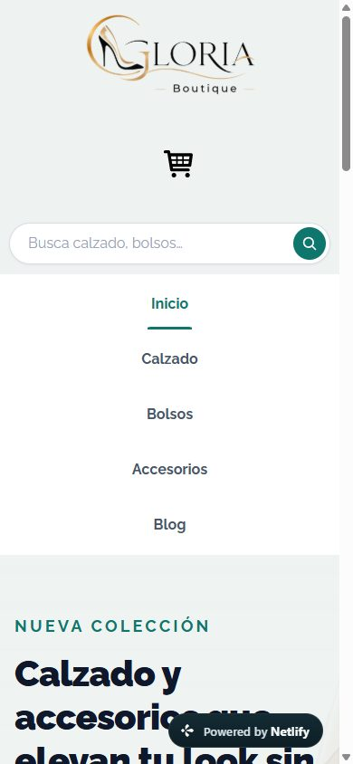

---

## 🏗️ Arquitectura

### Visión general

La aplicación sigue una **arquitectura de tres capas** —presentación, lógica de negocio y datos— comunicadas mediante una **API REST** con intercambio JSON. El frontend nunca accede directamente a la base de datos.

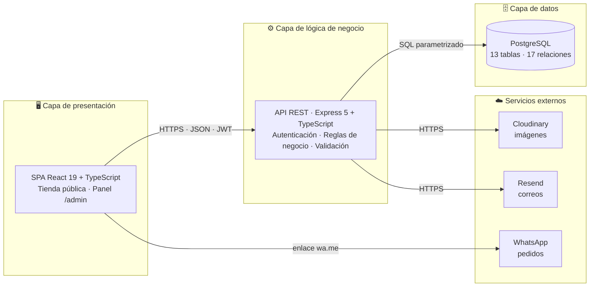

### Frontend

Aplicación de una sola página (SPA) construida con **React 19, TypeScript y Vite**. El estado del servidor se maneja con **TanStack Query** (caché, reintentos e invalidación) y el carrito con **Context API** persistido en el navegador.

| Carpeta | Responsabilidad |
|---|---|
| `pages/` | Páginas de la tienda (inicio, catálogo, detalle, búsqueda, blog) y del panel administrativo |
| `componentes/` · `ui/` | Componentes reutilizables: tarjetas, filtros, carrito lateral, buscador, encabezado, pie |
| `layout/` | Plantillas de la tienda, del acceso y del panel (barra lateral según el rol) |
| `api/` · `actions/` | Clientes HTTP (Axios) por módulo y consultas al backend |
| `hooks/` · `context/` | Lógica reutilizable y estado global del carrito |
| `router/` | Rutas públicas y rutas protegidas por rol (`ProtectedRoute`) |
| `utils/` | Precios y descuentos, transformaciones de Cloudinary, referencias, teléfono |

### Backend

API REST con **Node.js 22, Express 5 y TypeScript**, organizada por módulos. Cada petición pasa por una cadena de middlewares antes de llegar a la lógica de negocio.

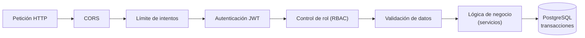

| Módulo | Responsabilidad |
|---|---|
| `auth/` | Inicio de sesión, recuperación de contraseña y gestión de usuarios y roles |
| `router.ts` (productos) | Catálogo público, búsqueda, CRUD de productos y galería de imágenes |
| `inventario/` | Combinaciones de talla y color, movimientos de stock e historial |
| `pedidos/` | Cotización, registro de pedidos, ventas presenciales, cambios de estado y reportes |
| `categorias/` · `configuracion/` | Categorías, subcategorías, filtros y configuración de la tienda |
| `middleware/` | Autenticación, roles, validación, límites de intentos y carga de archivos |
| `services/` | Integración con Cloudinary (imágenes) y Resend (correos) |
| `schema-postgres.ts` | Esquema idempotente: tablas, índices, restricciones y triggers |

### API REST (resumen)

| Recurso | Endpoints principales | Acceso |
|---|---|---|
| **Catálogo** | `GET /api/store` · `GET /api/store/:id` · `GET /api/store/search/:texto` | Público |
| **Productos** | `POST` · `PUT` · `PATCH /estado` · `DELETE /api/store/:id` · `POST /api/store/imagenes` | Administrador · Gestor |
| **Inventario** | `PUT /api/inventario/productos/:id` · `POST /api/inventario/variantes/:id/movimientos` · `GET /api/inventario/movimientos` | Administrador · Gestor (historial solo administrador) |
| **Pedidos** | `POST /api/pedidos/cotizacion` · `POST /api/pedidos` | Público (con límite) |
|  | `GET /api/pedidos` · `PATCH /api/pedidos/:id/estado` · `POST /api/pedidos/admin` · `GET /api/pedidos/reportes/ventas` | Administrador · Gestor |
| **Autenticación** | `POST /api/auth/login` · `POST /api/auth/forgot-password` · `POST /api/auth/reset-password` | Público (con límite) |
| **Usuarios** | `GET` · `POST` · `PUT` · `PATCH /estado` · `DELETE /api/auth/usuarios` | Administrador |
| **Categorías** | `GET /api/categorias` · `POST` · `PUT` · `PATCH /orden` · `DELETE /api/categorias/:id` | Público (lectura) · Administrador |
| **Configuración** | `GET` · `PUT /api/configuracion` | Administrador |

### Modelo de datos

Base de datos **PostgreSQL** con **13 tablas** organizadas en cuatro módulos y **17 llaves foráneas** con integridad referencial (`ON DELETE CASCADE` / `SET NULL`). Las referencias de producto (C001, B001…) las asigna un **trigger** de la base de datos.

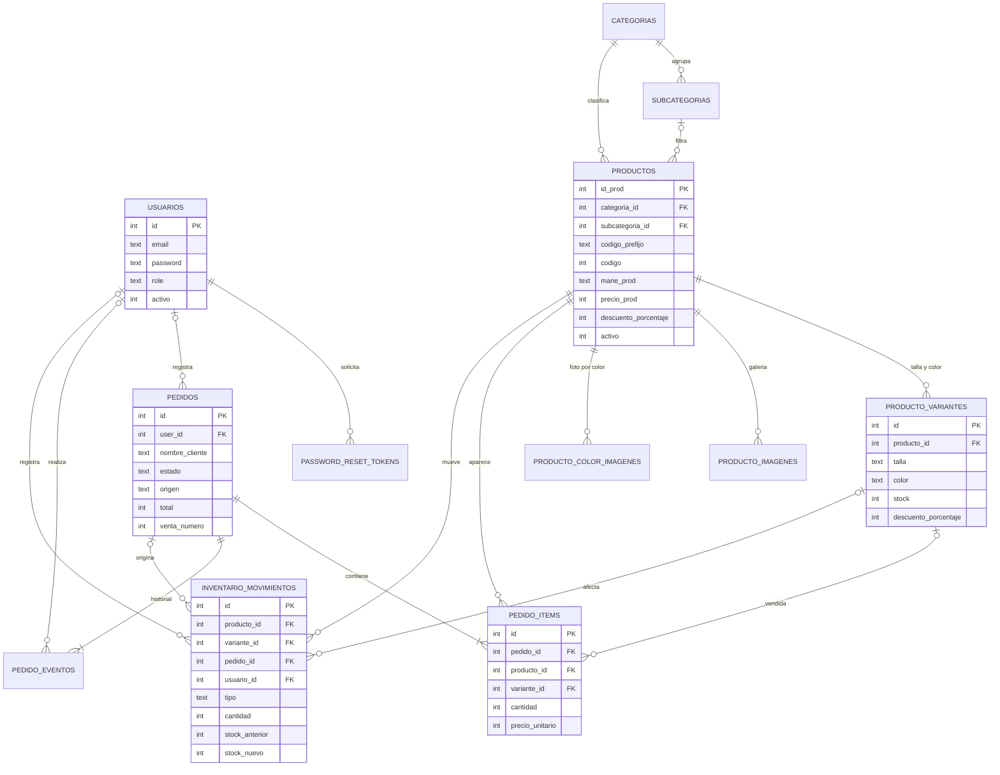

| Módulo | Tablas |
|---|---|
| Autenticación | `usuarios`, `password_reset_tokens` |
| Catálogo | `categorias`, `subcategorias`, `productos`, `producto_variantes`, `producto_imagenes`, `producto_color_imagenes` |
| Ventas e inventario | `pedidos`, `pedido_items`, `pedido_eventos`, `inventario_movimientos` |
| Configuración | `configuracion_tienda` |

### Flujo principal: del catálogo al pedido por WhatsApp

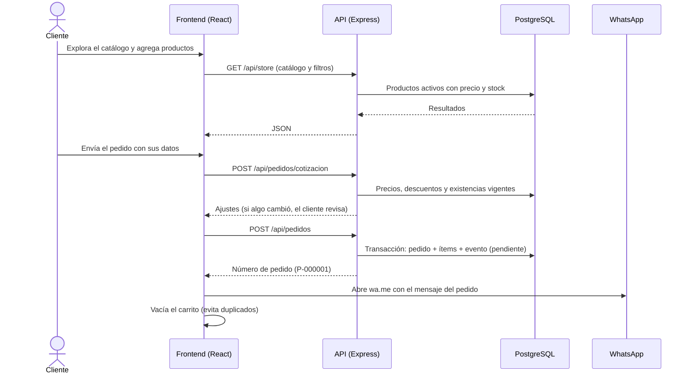

---

## 🔐 Seguridad

| Principio | Implementación |
|---|---|
| **Autenticación sin estado** | JWT firmado con expiración; la sesión se revalida contra la base en cada petición |
| **Contraseñas** | Cifrado con Bcrypt; nunca se guardan ni comparan en texto plano |
| **Control de acceso por roles (RBAC)** | Administrador y gestor de catálogo, verificados en el servidor (`requireRole`) y reflejados en la interfaz (`ProtectedRoute`) |
| **Menor privilegio** | El gestor no ve historial, usuarios ni configuración, y no cambia precios ni descuentos |
| **Integridad de precios** | El servidor calcula precios y totales; el cliente solo envía producto, talla, color y cantidad |
| **Límite de intentos** | Inicio de sesión, recuperación de contraseña y pedidos públicos |
| **Validación** | Todas las entradas se validan con `express-validator`; consultas SQL parametrizadas |
| **Trazabilidad** | Historial de quién crea, confirma o cancela cada pedido y de cada movimiento de inventario |
| **Configuración segura** | Secretos solo en variables de entorno, nunca en el código ni en el repositorio |

---

## ☁️ Despliegue

### Demo (esta publicación)

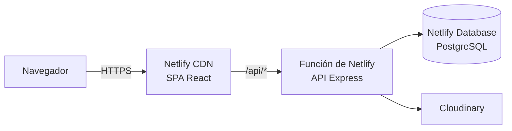

### Producción propuesta

Para la operación comercial se propone **AWS Lightsail** con **Docker Compose** y **Cloudflare**, con un costo estimado de **USD 24 al mes por servidor** (hasta 10 comercios por instancia).

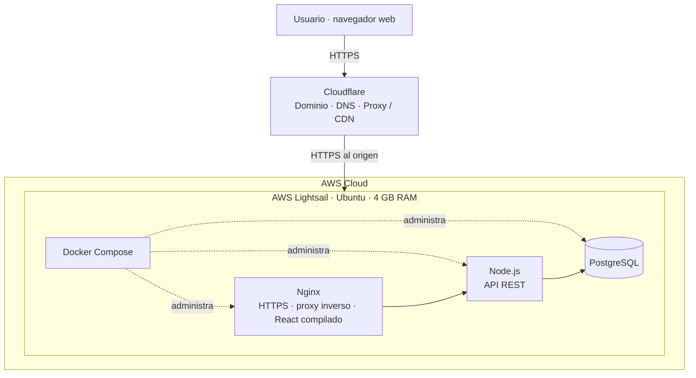

---

## 🧠 Decisiones técnicas

| Decisión | Motivo |
|---|---|
| **PostgreSQL** en lugar de SQLite | Concurrencia, transacciones con bloqueo de filas para el stock y despliegue en la nube (migración realizada durante el proyecto) |
| **Precios calculados en el servidor** | Evita que un cliente modifique precios o descuentos desde el navegador |
| **Inventario por combinación talla + color** | Refleja cómo vende realmente una tienda de calzado y permite alertas de stock precisas |
| **Pedidos por WhatsApp** en lugar de pasarela de pago | Es el canal que ya usan las microempresas; reduce costos y fricción en el MVP |
| **Cloudinary** para imágenes | Optimización automática (formato, calidad, recortes) y entrega por CDN sin cargar el servidor |
| **TanStack Query** | Caché y sincronización del estado del servidor sin estado global manual |
| **Esquema idempotente** | La base se crea y actualiza sola al iniciar, sin pasos manuales de migración |
| **Arquitectura por capas y módulos** | Separación de responsabilidades que facilita el mantenimiento y las pruebas |

---

## ✅ Calidad y pruebas

- **238 pruebas automatizadas** del backend: autenticación, roles, catálogo, inventario, pedidos, búsqueda, categorías, configuración y límites de acceso.
- **TypeScript estricto** en frontend y backend, y revisión con **ESLint**.
- Más de **25.000 líneas** de TypeScript, TSX y CSS escritas para el proyecto.
- Control de versiones con **Git**, con historial de cambios descriptivo.

---

## 💼 Competencias demostradas

| Área | Competencias |
|---|---|
| **Frontend** | React 19, TypeScript, diseño responsive, manejo de estado del servidor, formularios con validación, accesibilidad básica |
| **Backend** | APIs REST con Express, arquitectura por módulos, middlewares, transacciones, integración con servicios externos |
| **Bases de datos** | Modelado relacional, normalización, integridad referencial, índices, triggers y migración de SQLite a PostgreSQL |
| **Seguridad** | JWT, Bcrypt, RBAC, validación de entradas, protección contra abuso y manejo de secretos |
| **DevOps** | Despliegue en la nube (Netlify), arquitectura propuesta en AWS con Docker y Cloudflare |
| **Ingeniería de software** | Análisis de requisitos, diagramas UML, pruebas automatizadas y documentación técnica |
| **Producto y negocio** | Plan de negocio, análisis de mercado, modelo de ingresos SaaS, CAC y LTV |

---

## 👩‍💻 Autora

**Vanessa Osorio Ortiz** — Ingeniería de Software, UNIMINUTO

Desarrolladora full stack. Diseñé y construí Pisadas Digitales desde cero: desde el análisis del mercado y el modelo de datos hasta la API, la interfaz, la seguridad, las pruebas y el despliegue.

- 📧 vanessaosorio.dev@gmail.com
- 🔗 [github.com/vanessa-osorio-dev](https://github.com/vanessa-osorio-dev)

Proyecto académico y de emprendimiento · Santiago de Cali, 2026
